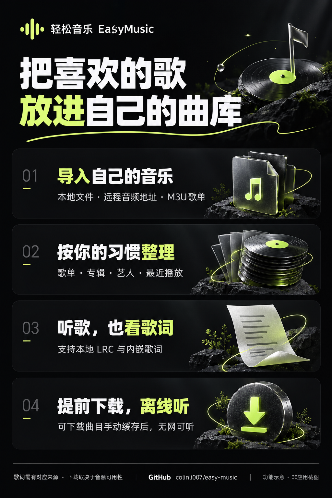

# 轻松音乐 EasyMusic：用免费开源播放器管理自己的曲库

已有本地音乐文件，却分散在不同目录；手里有音频链接或 M3U 歌单，又不想逐首整理。对这样的个人曲库，播放器需要把导入、分类、歌单和播放接在一起。

**轻松音乐 EasyMusic** 是一个免费、开源、无广告的个人音乐播放器，面向 Android 和 iOS。音乐由使用者自己准备，应用负责整理和播放，不内置音乐资源或插件源。

*AI 生成宣传插画，非应用截图。*

## 从已有音乐开始

当前代码提供三类导入入口：

| 手里的内容 | 导入方式 | 需要知道的边界 |
| --- | --- | --- |
| 本地音频文件 | 在导入入口选择文件，支持批量添加 | 标题、艺人、专辑和封面取决于文件中的元数据 |
| 可访问的远程音频 | 添加音频 URL | 是音频地址，不是任意音乐分享网页 |
| M3U / M3U8 普通歌单 | 选择播放列表文件或填写链接 | 不支持 HLS 分片清单；导入后不会随原列表自动更新 |

例如，把本地专辑导入曲库，再将想听的曲目整理进“通勤”歌单，就可以从同一份歌单连续播放。这个例子描述的是使用方式，不是预置歌单或赠送曲库。

## 整理方式围绕自己的曲库展开

曲库支持按歌单、专辑、艺人和已下载曲目查看。搜索可以匹配歌曲标题、艺人和专辑，排序可选最近添加、标题或艺人。

歌单支持新建、重命名和长按拖动曲目排序。播放支持顺序、列表循环、单曲循环和随机模式；首页也会展示最近播放过的曲目，方便接着听。

*AI 生成功能示意，非应用截图。分类、歌词和缓存能力依据当前源码整理。*

## 歌词与离线播放分别需要什么

歌词可以来自设置的本地歌词目录、音频内嵌歌词或用户自行安装的插件。有时间轴的歌词会随播放逐行高亮，纯文本歌词则按文本显示；没有对应来源时，播放器不会凭空生成歌词。

离线缓存需要先完成下载。对于来源可用且能够下载的远程曲目，可以手动下载，也可以从歌单发起批量下载。播放时先检查有效的本地缓存，命中后直接读取本地文件。

这里的离线能力不意味着任意资源都能下载，也不承诺完整曲目或无损音质。实际保存的内容由来源决定。

## 插件是可选扩展

不安装插件，也能使用本地文件、音频 URL、曲库、歌单和播放等核心能力。

自行安装的插件可扩展搜索、榜单、推荐歌单、专辑、艺人浏览、外部歌单导入及歌词，具体项目是否出现取决于插件实现。项目不内置或推荐插件源。插件没有隔离沙箱，能访问网络和应用数据，因此应自行确认来源可信。

## 获取方式与当前限制

源码以 GPL-3.0-or-later 授权公开，项目不上架应用商店。

截至 **2026 年 10 月 18 日**，[Releases 页面](https://github.com/colinli007/easy-music/releases)尚无发布版本，当前应按仓库“开发”说明自行编译。iOS 需要 Mac 与 Xcode；Android 可按仓库说明构建。不能把预留的 Releases 入口理解为已有 APK 可下载。

应用已实现后台音频能力，但[项目首页](https://github.com/colinli007/easy-music)仍列出两个已知问题：锁屏与控制中心没有上一首／下一首按钮；iOS 被其他应用抢占音频后，回到应用时播放按钮可能仍显示播放中。

它适合愿意管理自己音乐文件与音频来源的人。多设备同步、曲库备份、均衡器、倍速播放和网盘接入不在当前能力范围。

项目地址：[colinli007/easy-music](https://github.com/colinli007/easy-music)

如果你需要这样的个人播放器，欢迎查看源码和使用说明；觉得有用，可以点一个 Star。具体问题也欢迎附上复现步骤，通过 Issue 交流。
