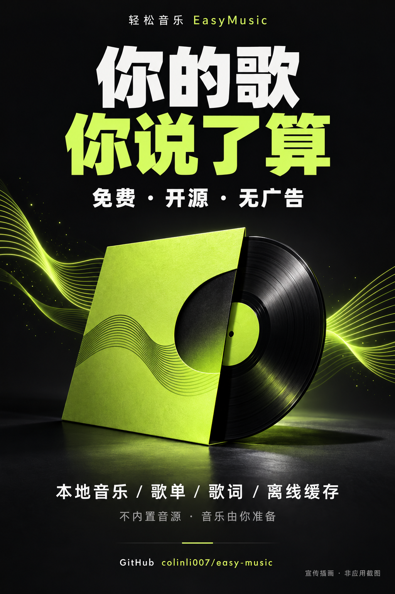
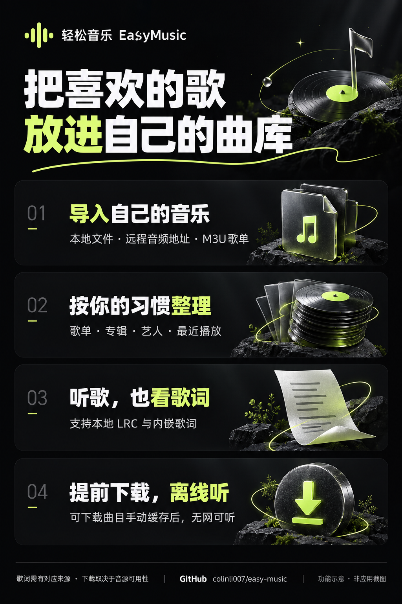

# 你的歌，你说了算｜轻松音乐

手机里存着喜欢的歌，想按专辑找、整理成歌单，出门时继续听。

「轻松音乐 EasyMusic」就是围绕这件事做的：**免费、开源、无广告的个人音乐播放器。**

*AI 生成宣传插画，非应用截图。*

把本地音乐导进来，也可以添加自己可访问的音频地址，或批量导入 M3U 歌单。

按歌单、专辑、艺人查看曲库；想调整歌单顺序，长按拖动就好。最近听过的歌，也能在首页找回来。

有对应歌词时，支持本地 LRC 和内嵌歌词；带时间轴的歌词会随播放逐行高亮。可下载的远程曲目提前手动缓存，保存成功后就能离线听。

*AI 生成功能示意，非应用截图。歌词需有对应来源，下载内容取决于音源。*

**音乐由你准备，播放交给轻松音乐。** 应用不内置音源，也不默认提供插件；“免费”指播放器本身，不是附带免费曲库。

目前是开源项目，不上架应用商店。Android 和 iOS 的代码都在仓库；截至 2026 年 10 月 18 日，尚无 Release 安装包，需要按仓库说明自行编译，iOS 需要 Mac 与 Xcode。

当前仍有两个已知问题：锁屏没有上一首／下一首按钮；iOS 被其他应用打断音频后，播放状态可能显示不准确。

项目入口：[colinli007/easy-music](https://github.com/colinli007/easy-music)

如果你也想整理自己的音乐，欢迎去看看；觉得项目有用，可以点个 Star 支持。

#开源项目 #音乐播放器 #本地音乐 #独立开发
